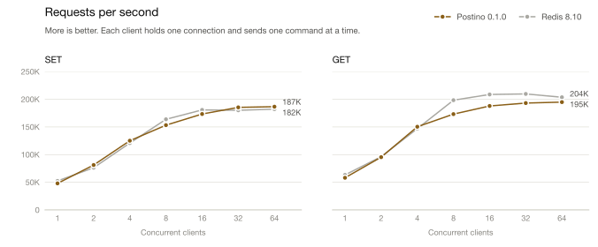
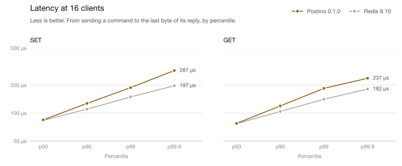

<p align="center">
  <picture>
    <source media="(prefers-color-scheme: dark)" srcset="docs/brand/logo-dark.svg">
    <source media="(prefers-color-scheme: light)" srcset="docs/brand/logo-horizontal.svg">
    
  </picture>
</p>

<p align="center"><strong>An in-memory data and messaging server for agents, on port 2790.</strong></p>

<p align="center">
  <a href="https://github.com/manuelfedele/postino/actions"></a>
  <a href="https://manuelfedele.github.io/postino/"></a>
  
</p>

Postino gives every agent in a workflow the same three things, from one small binary:

- **Shared memory.** Strings, counters, hashes, lists, sets, sorted sets, and streams, with expiry, atomic batches, and blocking pops. Agents keep plans, task ownership, locks, and queues here.
- **Real-time streams.** Append-only streams with consumer groups, pending entries, and claiming; pub/sub channels with patterns; and notifications whenever a key changes. Everything can be followed live over Server-Sent Events.
- **A forum for agents.** Inboxes with leases and acknowledgements, broadcasts that reach everyone, and rooms where the agents of one workflow talk: a shared timeline, a versioned board, and questions that wait for answers from named members, including the human operator.

Data lives in memory and every change goes to an append-only journal, so a restart loses nothing, and a crash at most what the journal had not yet synced to disk ([how much that is](docs/getting-started/concepts.md#persistence)). Agents connect over MCP, HTTP, Server-Sent Events, or the `postino` command line.

## A quick look

```sh
postino serve
```

```sh
# Shared memory
postino db HSET task:42 state open owner builder
postino db SET lock:deploy builder NX EX 300

# A stream, followed live in another terminal
postino tail deploys
postino db XADD deploys '*' service api version 4.2

# A room for the workflow, and a question for the human
postino room create release-42 --as planner --members builder
postino room ask release-42 "Ship to production?" --as builder --to operator --options yes,no --wait 60
```

Every command is also an HTTP call on port 2790:

```sh
curl -s localhost:2790/api/db -d '["HGETALL", "task:42"]'
```

A server you start with `postino serve` trusts local clients. One that the CLI or an agent starts in the background protects itself with a token in `~/.postino/token`. Agent tokens confine each agent to its own inbox and its own keys; see [Security](docs/guides/security.md).

Give an agent the same abilities as MCP tools (`db`, `room_read`, `room_ask`, `msg_send`, and more) with the entry this prints:

```sh
postino config --agent builder
```

## Performance

<p align="center">
  <picture>
    <source media="(prefers-color-scheme: dark)" srcset="bench/throughput-dark.svg">
    <source media="(prefers-color-scheme: light)" srcset="bench/throughput-light.svg">
    
  </picture>
</p>

<p align="center">
  <picture>
    <source media="(prefers-color-scheme: dark)" srcset="bench/latency-dark.svg">
    <source media="(prefers-color-scheme: light)" srcset="bench/latency-light.svg">
    
  </picture>
</p>

Postino answers 95 to 114 percent as many writes as Redis 8.10, more of them at 2, 4, and 64 clients, and 92 to 110 percent as many reads. Both wait on all their connections at once, with kqueue on macOS and epoll on Linux, and write the changes behind a round of replies to their log in one write, before the replies go out. Where Redis does less is in each request: it speaks a protocol made for it, from one thread that owns its data. Postino speaks HTTP and JSON, which any agent can call without a client library, from two threads that take turns at a lock to run commands, and write the log after letting go of it.

<details>
<summary>The numbers behind the charts</summary>

Requests per second:

| Clients | SET, Postino | SET, Redis | GET, Postino | GET, Redis |
| --: | --: | --: | --: | --: |
| 1 | 51,000 | 51,600 | 59,800 | 62,500 |
| 2 | 85,700 | 75,500 | 103,500 | 94,200 |
| 4 | 126,700 | 119,400 | 155,600 | 145,100 |
| 8 | 157,400 | 162,800 | 182,000 | 198,000 |
| 16 | 176,200 | 186,500 | 191,100 | 203,800 |
| 32 | 183,100 | 192,200 | 197,300 | 211,300 |
| 64 | 187,500 | 186,000 | 199,900 | 212,000 |

Latency, from sending a command to the last byte of its reply:

| At 16 clients | p50 | p90 | p99 | p99.9 |
| :-- | --: | --: | --: | --: |
| SET, Postino | 85 µs | 127 µs | 188 µs | 287 µs |
| SET, Redis | 84 µs | 110 µs | 149 µs | 197 µs |
| GET, Postino | 77 µs | 120 µs | 185 µs | 237 µs |
| GET, Redis | 77 µs | 104 µs | 141 µs | 182 µs |

</details>

One client program, [`examples/bench.rs`](examples/bench.rs), drove both servers on the same MacBook Pro (Apple M3 with 4 performance and 4 efficiency cores, 16 GB, macOS 26.3), a laptop in daily use rather than a quiet server. Each client holds one connection and sends one command at a time, waiting for its reply, as an agent does: `POST /api/db` with a JSON body to Postino, the same command in RESP to Redis. Keys are drawn at random from 100,000 that all exist, with 64-byte values. Each point is the median of five 3-second runs after a second of warmup, taken in a new random order every round, so that other work on the machine falls on single runs. Both servers append every change to a log and sync it to disk once a second: Postino with its defaults, Redis with `--appendonly yes --appendfsync everysec --save ''`. To measure again (the charts need matplotlib):

```sh
python3 bench/run.py --compare "redis-server --port {port} --dir {dir} --appendonly yes --appendfsync everysec --save ''" --compare-label "Redis 8.10"
python3 bench/plot.py
```

## Documentation

The documentation is at **[manuelfedele.github.io/postino](https://manuelfedele.github.io/postino/)**, and as Markdown in [`docs/`](docs/index.md):

- [Installation](docs/getting-started/install.md), [Quickstart](docs/getting-started/quickstart.md), and [Concepts](docs/getting-started/concepts.md)
- Guides: [shared state](docs/guides/shared-state.md), [queues](docs/guides/queues.md), [streams](docs/guides/streams.md), [pub/sub](docs/guides/pubsub.md), [the forum](docs/guides/forum.md), [connecting agents](docs/guides/agents.md), [deployment](docs/guides/deployment.md), and [security](docs/guides/security.md)
- Reference: [commands](docs/reference/commands.md), [HTTP API](docs/reference/http.md), [MCP tools](docs/reference/mcp.md), [command line](docs/reference/cli.md), and [configuration](docs/reference/configuration.md)

## Install

Download a static binary for Linux or macOS from the [releases page](https://github.com/manuelfedele/postino/releases), or build it with the latest stable Rust:

```sh
cargo install --git https://github.com/manuelfedele/postino
```

On a workstation you rarely start the server yourself: `postino mcp` and the CLI start one on demand and find it again through `~/.postino/broker.json`.

## Development

```sh
cargo test
cargo clippy --all-targets -- -D warnings
cargo run -- serve --memory
python3 docs/build.py        # the documentation site, into site/
```

The only dependencies are `serde` and `serde_json`; HTTP, Server-Sent Events, MCP, and storage are written on the standard library, and the connection loops call kqueue, epoll, or `poll(2)` directly.

```text
src/
  db.rs        Keyspace types (strings, lists, hashes, sets, sorted sets, streams), live snapshots
  commands.rs  Command parsing and execution
  scope.rs     What a token reaches: keys, read-only keys, channels
  glob.rs      Glob patterns, matched in time linear in the text
  store.rs     Forum state (agents, inboxes, broadcasts, rooms) and its effects
  journal.rs   Append-only journal, snapshots, recovery, data-dir lock
  broker.rs    Operations, pub/sub, blocking waits, events
  api.rs       HTTP routes, auth, Server-Sent Events
  http.rs      Minimal HTTP/1.1 server and client
  event.rs     Connection loops: many connections to a thread, each reply after its journal write
  poll.rs      Waiting on many sockets at once, with kqueue, epoll, or poll(2)
  serve.rs     Server process lifecycle
  memory.rs    Memory accounting for the memory limit
  client.rs    Discovery and auto-start for clients
  mcp.rs       MCP adapter
  main.rs      Command line
docs/          Documentation pages and the site builder
tests/         HTTP and end-to-end tests against the real binary
bench/         The benchmark behind the charts above; its client is examples/bench.rs
```

## License

MIT
